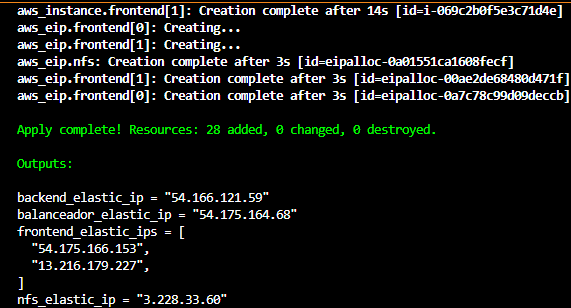
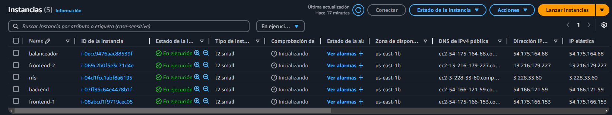
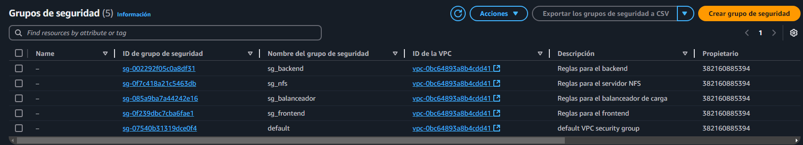
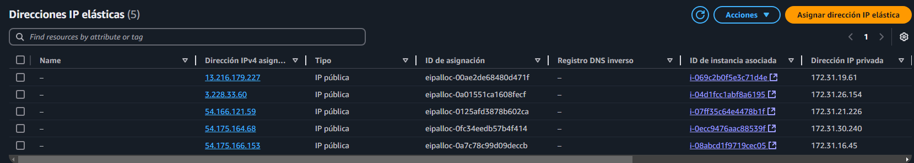

# Practica-IAW-4.5- Ejercicio con Terraform

## Ejercicio 1. Crear un script para crear la infraestructura de la práctica 1.11.

```bash
provider "aws" {
  region = var.region
}

# Creamos el grupo de seguridad: frontend-sg
resource "aws_security_group" "frontend" {
  name        = var.SECURITY_GROUP_FRONTEND
  description = "Reglas para el frontend"
}

# Creamos las reglas de entrada para frontend-sg
resource "aws_security_group_rule" "frontend_ingress" {
  count             = 5
  security_group_id = aws_security_group.frontend.id
  type              = "ingress"
  from_port         = [22, 2049, 80, 443, 3306][count.index]
  to_port           = [22, 2049, 80, 443, 3306][count.index]
  protocol          = "tcp"
  cidr_blocks       = ["0.0.0.0/0"]
}

# Creamos el grupo de seguridad: backend-sg
resource "aws_security_group" "backend" {
  name        = var.SECURITY_GROUP_BACKEND
  description = "Reglas para el backend"
}

# Creamos las reglas de entrada para backend-sg
resource "aws_security_group_rule" "backend_ingress" {
  count             = 2
  security_group_id = aws_security_group.backend.id
  type              = "ingress"
  from_port         = [22, 3306][count.index]
  to_port           = [22, 3306][count.index]
  protocol          = "tcp"
  cidr_blocks       = ["0.0.0.0/0"]
}

# Creamos el grupo de seguridad: balanceador-sg
resource "aws_security_group" "balanceador" {
  name        = var.SECURITY_GROUP_BALANCEADOR
  description = "Reglas para el balanceador de carga"
}

# Creamos las reglas de entrada para balanceador-sg
resource "aws_security_group_rule" "balanceador_ingress" {
  count             = 5
  security_group_id = aws_security_group.balanceador.id
  type              = "ingress"
  from_port         = [22, 3306, 80, 443, 2049][count.index]
  to_port           = [22, 3306, 80, 443, 2049][count.index]
  protocol          = "tcp"
  cidr_blocks       = ["0.0.0.0/0"]
}

# Creamos el grupo de seguridad: nfs-sg
resource "aws_security_group" "nfs" {
  name        = var.SECURITY_GROUP_NFS
  description = "Reglas para el servidor NFS"
}

# Creamos las reglas de entrada para nfs-sg
resource "aws_security_group_rule" "nfs_ingress" {
  count             = 2
  security_group_id = aws_security_group.nfs.id
  type              = "ingress"
  from_port         = [22, 2049][count.index]
  to_port           = [22, 2049][count.index]
  protocol          = "tcp"
  cidr_blocks       = ["0.0.0.0/0"]
}

# Creamos instancias EC2 para el frontend
resource "aws_instance" "frontend" {
  count           = 2
  ami             = var.ami_id
  instance_type   = var.instance_type
  key_name        = var.key_name
  security_groups = [aws_security_group.frontend.name]

  tags = {
    Name = "frontend-${count.index + 1}"
  }
}

# Creamos una instancia EC2 para el backend
resource "aws_instance" "backend" {
  ami             = var.ami_id
  instance_type   = var.instance_type
  key_name        = var.key_name
  security_groups = [aws_security_group.backend.name]

  tags = {
    Name = "backend"
  }
}

# Creamos una instancia EC2 para el balanceador de carga
resource "aws_instance" "balanceador" {
  ami             = var.ami_id
  instance_type   = var.instance_type
  key_name        = var.key_name
  security_groups = [aws_security_group.balanceador.name]

  tags = {
    Name = "balanceador"
  }
}

# Creamos una instancia EC2 para el NFS
resource "aws_instance" "nfs" {
  ami             = var.ami_id
  instance_type   = var.instance_type
  key_name        = var.key_name
  security_groups = [aws_security_group.nfs.name]

  tags = {
    Name = "nfs"
  }
}

# Asociamos IPs elásticas a las instancias frontend
resource "aws_eip" "frontend" {
  count    = 2
  instance = aws_instance.frontend[count.index].id
}

# Asociamos una IP elástica a la instancia backend
resource "aws_eip" "backend" {
  instance = aws_instance.backend.id
}

# Asociamos una IP elástica a la instancia balanceador
resource "aws_eip" "balanceador" {
  instance = aws_instance.balanceador.id
}

# Asociamos una IP elástica a la instancia NFS
resource "aws_eip" "nfs" {
  instance = aws_instance.nfs.id
}
```

el archivo de varibles es el siguiente:

```bash
variable "region" {
  description = "Región de AWS donde se creará la instancia"
  type        = string
  default     = "us-east-1"
}

variable "allowed_ingress_ports" {
  description = "Puertos de entrada del grupo de seguridad"
  type        = list(number)
  default     = [22, 80, 443]
}

variable "sg_name" {
  description = "Nombre del grupo de seguridad"
  type        = string
  default     = "sg_ejemplo_06"
}

variable "sg_description" {
  description = "Descripción del grupo de seguridad"
  type        = string
  default     = "Grupo de seguridad para la instancia de ejemplo 06"
}

variable "ami_id" {
  description = "Identificador de la AMI"
  type        = string
  default     = "ami-00874d747dde814fa"
}

variable "instance_type" {
  description = "Tipo de instancia"
  type        = string
  default     = "t2.small"
}

variable "key_name" {
  description = "Nombre de la clave pública"
  type        = string
  default     = "vockey"
}

variable "instance_name" {
  description = "Nombre de la instancia"
  type        = string
  default     = "instancia_ejemplo_06"
}

variable "SECURITY_GROUP_FRONTEND" {
  description = "Nombre del grupo de seguridad para el frontend"
  type        = string
  default     = "sg_frontend"
}

variable "SECURITY_GROUP_BACKEND" {
  description = "Nombre del grupo de seguridad para el backend"
  type        = string
  default     = "sg_backend"
}

variable "SECURITY_GROUP_BALANCEADOR" {
  description = "Nombre del grupo de seguridad para el balanceador de carga"
  type        = string
  default     = "sg_balanceador"
}

variable "SECURITY_GROUP_NFS" {
  description = "Nombre del grupo de seguridad para el servidor NFS"
  type        = string
  default     = "sg_nfs"
}
```




